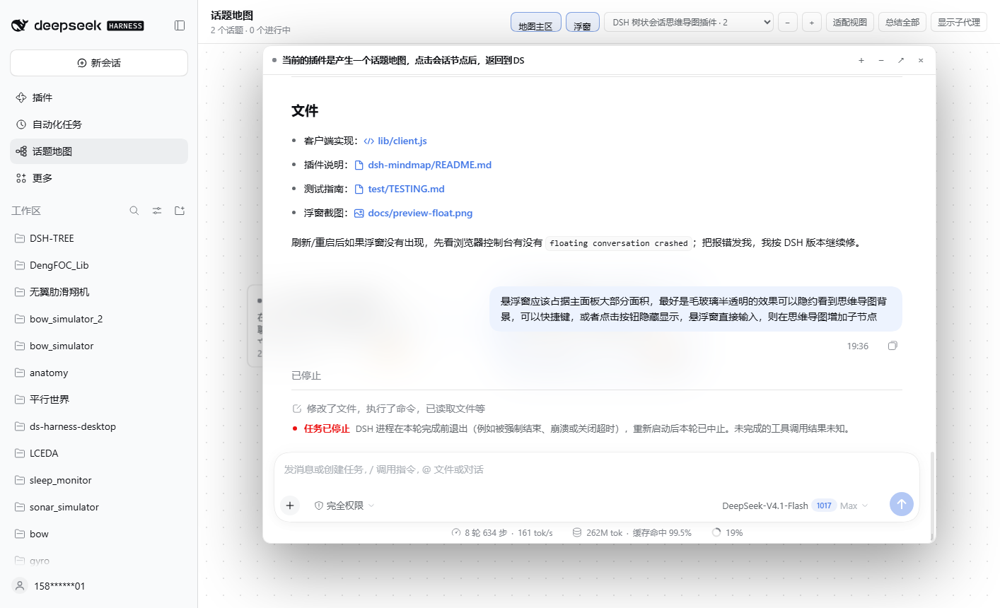
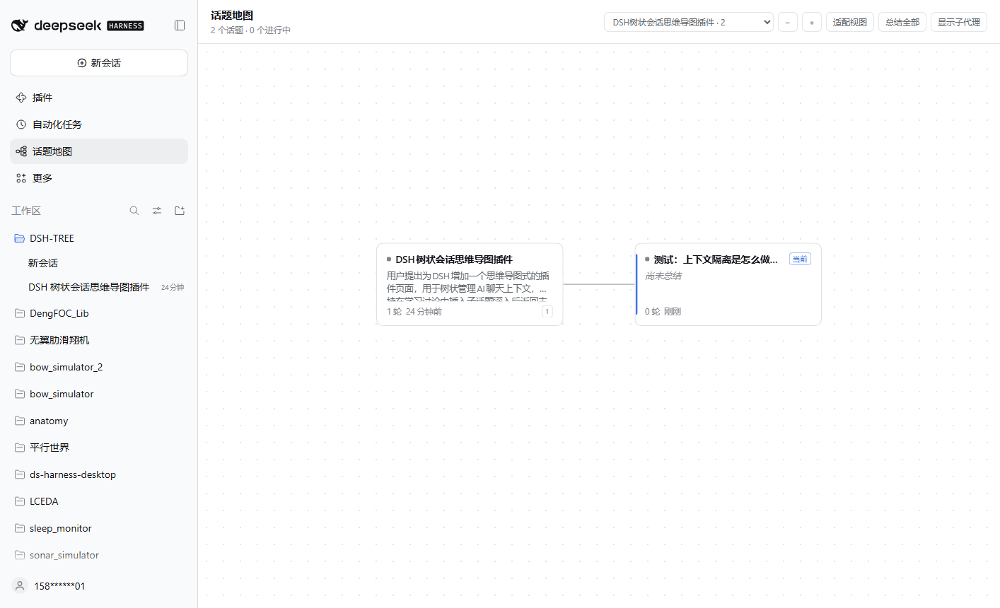
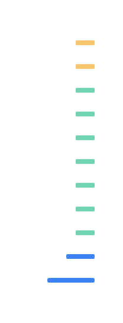

# dsh-mindmap

把 DSH 的主面板变成一张**思维导图**，并把会话装进一个可拖拽、可缩放的**悬浮窗**：

- **地图主区**：左栏选择任意话题，主面板不会切回会话，而是载入该话题的树并聚焦节点；
- **浮窗即子话题**：节点获得焦点后按 `Ctrl+Shift+M` 或点按钮，浮窗打开一个继承当前上下文的子话题草稿；在浮窗里直接输入并发送，思维导图**当场长出子节点**，浮窗随后切换到该子话题继续对话；
- **大尺寸毛玻璃**：默认四周留 28px，占据地图内容区约 95%，半透明 + 背景模糊，能隐约看到下面的地图；八方向拖动边框/角可改大小，尺寸会记住，直到你再次调整；
- **会话清理**：浮窗标题栏 `🗑` 归档当前会话，确认后从侧栏和地图移除；会话日志保留，可在归档中恢复；
- **轮次回退**：浮窗 `☰` 列出节点内的每一轮；选一轮「从此轮重开」，会创建一个只保留该轮之前历史的新节点，该轮及之后被切掉，旧节点归档；
- **浮窗状态保持**：浮窗打开后会一直保持打开，回合完成、页面刷新或地图重新挂载都不会把它关掉；只有 `×` 或 `Ctrl+Shift+M` / 顶部「浮窗」按钮会切换状态；
- **轮次导航层级色**：浮窗右侧官方的「轮次导航」按层级固定着色——当前节点蓝、父节点绿、祖父节点琥珀、更高层紫/粉/灰；只给导航条着色，消息正文不变，也不加图例；
- **标题同步重命名**：节点 `✎`、详情「重命名」、浮窗 `✎` 都能弹出重命名窗口；写回 DSH 的 session title 后，左侧栏、地图卡片和浮窗标题同步。反过来，在左侧栏重命名也会立即反映到地图；卡片主标题始终使用会话标题，摘要 topic 不再覆盖它；
- **不污染父话题**：子话题从父会话的精确前缀 fork，回到父话题时父会话不会带上子话题的上下文。



> 真实 DSH 会话：地图占主区，大尺寸浮窗里是官方 `conversation.content`（消息、输入框、`+` 添加文件、完全权限、DeepSeek-V4.1-Flash / 1017 / Max）。

> 想上架 DSH 插件市场？见 [PUBLISHING.md](PUBLISHING.md)。仓库和市场展示名保留 `dsh-mindmap`，npm 包使用 scoped 名 `@zhengxiantai/dsh-mindmap`。



> 同一张图的分叉效果：从“DSH 树状会话思维导图插件”生长出“测试：上下文隔离是怎么做到的？”子话题。

---

## 地图主区与会话浮窗

DSH 的 `main` 是 keyed slot，一次只渲染一个面板。本插件把地图注册为 `main` 面板，并做三件事：

1. **地图优先**：包装 `uiWorkspace.openSession` 并监听 `ctx.layout.panelInfo`。当地图模式开启时，左栏点击会话只会 retain/select 该会话并把主面板切回地图，地图随后 root 到该话题、聚焦节点；右侧栏、文档标题、完成提醒仍跟随选中会话。
2. **浮窗即子话题**：`Ctrl+Shift+M` / 底部 CTA / 节点 `+` 在当前节点下 fork 一个子会话，浮窗直接绑定它；子会话在收到第一条新消息前是**草稿**，地图不显示；发送后地图出现子节点，浮窗切到普通对话，后续消息继续这个子话题。关闭草稿（×）会归档未用的 fork；最小化/隐藏则保留。
3. **查看已有对话**：双击节点、节点 `◱`、详情「查看对话」打开普通浮窗，输入继续当前话题，不再创建子节点。

浮窗渲染官方 `conversation.content` factory：

   ```jsx
   <SessionProvider session={reference}>
     {renderFactorySlot('conversation.content', {
       variant: 'embedded', phase: 'active', hero: false,
     })}
   </SessionProvider>
   ```

这个 factory 包含消息视图、输入框、`conversation.input.attachments`（添加文件）、`conversation.input.permission`（权限预设）、`conversation.input.model`（模型/推理强度）以及工具卡、审批、停止按钮等，都是官方组件。

浮窗自绘标题栏、拖拽、缩放、最小化、几何记忆、隐藏/恢复、`🗑` 归档和「在主页打开」；没有使用官方 `main.conversation` 的 header（标题/面包屑/视图 tab/会话菜单），这部分自绘精简版。

`🗑` 调用 `uiWorkspace.archiveSession(id, { stopActivity: true })`：从侧栏和地图移除，运行中的工作先停止；这是 DSH 的**归档**语义，不是永久删除，日志仍在，可在归档里恢复。地图通过订阅 `uiWorkspace.workspaces.list` 的 `archivedSessionIds` 过滤归档会话。

### 轮次回退（不是原地删消息）

浮窗标题栏的 `☰` 打开轮次列表。Host 半侧通过 `ctx.sessionQuery.observeSession(id)` 读取**完整原始事件**，按 `user/message` 切出每一轮，返回 `startSeq / endSeq / preview / time`。

选「从此轮重开」时：

- 用 `ctx.sessions.fork({ sessionId, atSeq: startSeq - 1 })` 创建一个新节点（`atSeq` 是**包含式**边界，所以用 `startSeq - 1` 保留该轮之前的事件）；
- 新节点继承该轮之前的历史；
- 这一轮及之后的轮次不会进入新节点；
- 旧节点归档（可恢复），地图上由新节点接替它的位置；如果旧节点有子话题，子话题会提升到最近的可见祖先下；
- 新节点标题会尝试改为「旧标题 · 回退」。

这个功能是 **A：轮次级回退**，效果是“删掉这一轮及之后”，不是从中间抽掉一轮后保留后面的轮次。后者需要重写 append-only 日志，未实现。

### 轮次导航层级色

浮窗右侧、贴着滚动条的官方「轮次导航」（`nav[aria-label="轮次导航"]`，每轮一根可点击短横条）会按**相对当前节点的层级**固定着色：

| 层级 | 含义 | 颜色 |
|---|---|---|
| 0 | 当前节点自己的轮次 | 蓝 `#3b82f6` |
| 1 | 从父节点继承的轮次 | 绿 `#10b981` |
| 2 | 从祖父节点继承的轮次 | 琥珀 `#f59e0b` |
| 3 | 曾祖父节点 | 紫 `#8b5cf6` |
| 4 | 更高层 | 粉 `#ec4899` |
| 5+ | 更深祖先 | 灰 `#64748b` |



判定方法：

- Host 的 `/mindmap/api/turns` 在原始事件里找 `session/end-seed` 且 `data.inherited === true` 的事件，这些是 fork 时复制前缀的边界；
- 结合 `turnOutline` projection 的每个 `turn/start.seq`，一个轮次的 `level = 边界中 >= 该轮 startSeq 的个数`；
- 当前节点自己的轮次没有边界压在上面，level 0；父节点前缀跨过 1 个边界，level 1；祖父跨 2 个，以此类推；
- Client 只监听 `.mm-float` 内的 `nav button[data-index]`，把 `--dsw-alias-border-l4` 和 `--dsw-alias-label-primary` 改成对应层级色，因此只影响导航条的 `::before`，不改消息、不改全屏对话；
- 颜色是常量数组，不会随机生成；没有图例/徽标（按当前需求保持简洁）。

### 浮窗状态保持

浮窗的 `open / sessionId / mode / parentId / brief` 会写进 localStorage（`dsh-mindmap.floatState.v1`）。回合完成只更新会话数据，不会改 `float.open`；同时：

- `showChat` 打开失败时不再关闭已有浮窗；
- 子话题草稿 settle 成正式节点时只切 `mode`，不重新打开/关闭浮窗；
- 浮窗打开期间监听 `ctx.layout.panelInfo`，任何自动面板切换都会把地图切回来，避免地图卸载导致浮窗消失；
- 页面刷新或地图重新挂载后，会从 localStorage 恢复原来的浮窗状态；隐藏的浮窗保持隐藏，直到用户再次切换。

### 几何与拖拽缩放

- 默认几何：`x = 28`、`y = 地图 header 高度 + 28`、`w = 面板宽 - 56`、`h = 面板高 - header - 56`，即左右下各留 28px，顶部在地图工具栏下方留 28px；
- 八方向缩放手柄：上/下/左/右 + 四角，最小 `400 × 280`；
- 拖标题栏移动、拖任意边/角改大小；`pointerup` 时把 `x/y/w/h` 写入 `dsh-mindmap.float.v2`，下次打开、刷新或重启后沿用，直到用户再次调整；
- 如果窗口被缩小、保存的尺寸超出当前面板，会临时 clamp 到可视范围，但不会覆盖原记录。

**右侧栏不会进入浮窗。** `dsh-better-sidebar` 的文件/变更/任务 tabs 属于独立的 `rightbar` slot，底部工作台属于 `shell.bottom`；它们会继续停靠在右侧/底部，并跟随当前选中的会话。浮窗限制在中栏内，不覆盖右栏。

浮窗依赖 `conversation.content` 这个**内部 factory 契约**（机制是公开的 Component Factory，具体名字/入参不是文档承诺），以及 `conversation.input` 的 draft 读取用于子话题命名。插件做了运行时探测和 `FloatBoundary` 回退：版本不兼容时显示「在主页打开」，不会影响地图。

---

## 为什么“回到主话题不会上下文爆炸”

这不是插件在提示词里做了裁剪，而是 DSH 会话模型本身的性质，插件只是把它变得好用：

- 每个会话是一份 append-only 的事件日志，模型历史由日志派生；
- fork 会从源日志的**精确前缀**复制出子会话，之后两个会话各写各的日志；
- 所以子话题里发生的任何事都不会写进父会话，父会话回到主线时上下文与分叉前完全一致。

插件提供两种分叉方式，对应两种“上下文预算”：

| 模式 | 做法 | 适合 |
|---|---|---|
| **继承当前上下文** | `ctx.sessions.fork({ sessionId })`，默认切在最后一个**完整轮次**的边界 | 顺着当前思路深入，子话题需要完整背景 |
| **轻量子话题** | `ctx.sessions.fork({ sessionId, atSeq: 0 })`，只保留源会话的种子事件；不自动带父摘要，直接在浮窗里写新问题 | 跳出去查一个独立概念，希望子话题上下文尽量小 |

回到父话题时，还有一个可选的“**把结论带回父话题**”：把子话题的自动摘要作为草稿追加到父会话输入框（只预填，不自动发送）。这样主线知道结论，但没有子话题的过程。

---

## 它是怎么挂进 DSH 的

DSH 的插件是 Cordis 插件，一个包可以同时有 **Host 半侧**（Node，`lib/index.js`）和 **Client 半侧**（浏览器 bundle，`lib/client.js`）。`package.json` 的 `dsh` 字段声明 bundle patch 与浏览器入口，Loader 把它作为一行挂进 profile 的插件树。

```text
package.json
  dsh.bundle.patch -> cordis.patch.yml   # 一行 insert: { id: mindmap, name: @zhengxiantai/dsh-mindmap }
  dsh.client       -> platform: web      # 扫描出 lib/client.js，注入 window.__DSH_BOOT__
  exports["./client"]
```

**硬性约定（0.9.0 起）**：`lib/client.js` 的 `window.__ModuleLoader__.load({ id })` 必须等于 `package.json` 的 `name`。client-modules 用包名索引启动图，id 不一致时页面会抛 `no registered factory for "<包名>"`，Host 半侧照常工作、Client 半侧完全不出现——这正是 0.8.0 从市场装到别的电脑后“装了但没反应”的原因（当时本地挂载把包名改成了 `dsh-mindmap`，把问题盖住了）。`test/client.test.mjs` 现在会直接比对这两个值。

### 兼容性

| 项 | 值 |
|---|---|
| 已验证 DSH | `0.2.2-rc.5`（Desktop / Web profile 均验证） |
| `engines.dsh` | `>=0.2.2-rc.1 <0.3.0-0` |
| `engines.node` | `>=24.9`（DSH 0.2.1-rc.2 起要求 Node 24） |

0.8.0 → 0.9.0 的适配内容：Client 工厂 id 改为 scoped 包名（决定性修复）；本地 `install.ps1` 改为 scoped 挂载；`engines.dsh` 明确声明；`health.version` 跟随发版。0.2.2 的右键菜单前缀、CSS 锚定菜单、窗口区域等改动不影响本插件（它只用自己的浮层，不用全局菜单/拖拽区域）。


### 复用的 DSH 扩展点

| 位置 | 扩展点 | 用途 |
|---|---|---|
| Host | `ctx.webServer.register({ kind: 'prefix', path: '/mindmap/api' })` | 给页面提供 summaries / summarize / health 三个本地接口 |
| Host | `ctx.sessionQuery.observeSession()` | 读取完整原始日志，切出每轮 `startSeq/endSeq` 供回退 |
| Host | `ctx.sessionQuery.readSurface()` / `readTitleSnapshots()` / `listSessions()` | 读取任意冷/热会话的模型表层、标题与父子关系，不需要打开会话 |
| Host | `ctx.llm.prepareCall()` + `prepared.stream()` | 总结调用；默认复用该会话最后一次请求记录里的 provider/model，插件不引入第二个模型客户端 |
| Host | `ctx.tools.register(defineTool(...))` | 注册只读工具 `mindmap_topics`，让模型直接读话题树 |
| Client | `main` keyed slot + `sidebar.panellist` | 注册「话题地图」主面板与侧边栏入口 |
| Client | `SessionProvider` + `renderFactorySlot('conversation.content')` | 在浮窗里渲染官方会话正文、输入框、附件、权限、模型/推理 |
| Client | `ctx.layout.panelInfo` + `uiWorkspace.openSession` guard | 地图优先：左栏选会话不切走主面板 |
| Client | `ctx.sessions.list` | 实时会话树、标题、`sessionStats`（轮次/步骤）、运行状态 |
| Client | `ctx.sessions.fork()` / `rename()` | 建子话题、命名 |
| Client | `ctx.get('uiWorkspace').openSession()` / `archiveSession()` | 打开任意话题的对话 / 归档节点 |
| Client | `ctx.sessions.fork({ atSeq })` | 轮次回退：按轮次边界创建新前缀分支 |
| Client | `ctx.get('conversation').input.requestDraftInitialization()` | 把问题/摘要预填进目标会话的输入框 |
| Client | `ctx.locale` | 中英文案 |

### 数据流

```text
┌──────────────────────────── 浏览器 ────────────────────────────┐
│ 话题地图 main panel                                             │
│  ├─ ctx.sessions.list ────────────► 实时树 / 标题 / 统计        │
│  ├─ POST /mindmap/api/summaries ──► 读取摘要缓存                │
│  ├─ POST /mindmap/api/summarize ──► 生成/刷新一个话题摘要       │
│  ├─ ctx.sessions.fork + rename ───► 新建子话题                  │
│  ├─ uiWorkspace.openSession ──────► 选中会话（guard 保持地图）  │
│  ├─ SessionProvider + factory ────► 浮窗里的官方会话正文         │
│  └─ conversation.input ───────────► 预填问题 / 带回结论         │
└───────────────────────────────┬────────────────────────────────┘
                                │ 同源 fetch（本地回环）
┌───────────────────────────────▼────────────────────────────────┐
│ Host 半侧                                                       │
│  ├─ sessionQuery：读表层、标题、血缘                             │
│  ├─ llm：按会话自己的 provider/model 调用一次总结                │
│  ├─ tools：mindmap_topics（只读话题树）                         │
│  └─ $DSH_HOME/storages/mindmap/summaries.json（摘要缓存）       │
└─────────────────────────────────────────────────────────────────┘
```

### 摘要的生成与缓存

- 缓存键是 `sessionId`，条目里带 `seq`（`readSurface().capturedThroughSeq`）、`topic`、`summary`、`open[]`、`at`、`model`；
- 页面打开时先批量读缓存，再对“空闲、至少 1 轮、缓存落后于 `updatedAt`”的节点**逐个**生成，最多 3 个一批，避免一次打开就打一串模型请求；
- 同一 `sessionId` 的并发请求在 Host 侧合并成一个 Promise；
- 摘要提示词要求模型返回 `{"topic","summary","open"}`，只用该分支自己的对话，不虚构；
- 模型路由优先用会话最后一条 assistant 消息里的 `source.provider/model`，其次插件配置的 `provider/model`，都没有时退化为不带模型的确定性摘要（卡片上标“离线概要”）；
- 摘要是**插件自己的元数据**，不写入会话日志，也不进入模型上下文。

### 自动命名

DSH 本身有 `session-title` 服务（默认取首条用户消息，官方还提供“随对话更新的标题”实验性 bundle）。fork 出来的子会话默认继承父标题，因此本插件在子话题发送第一条消息时用问题重命名它。**地图卡片主标题始终读会话标题**（与左栏同步），摘要的 `topic` 只是 AI 概要，不再覆盖用户重命名。

- 不会覆盖用户手动改过的标题（插件不写 `session/title`，除非创建分支时显式改名）；
- 想让侧边栏标题也随对话自动更新，在“设置 → 插件”里启用官方的 **随对话更新的标题**（`@deepseek-ai/dsh-experimental-session-titles-bundle`）。

### 模型侧工具：`mindmap_topics`

Host 半侧注册了一个只读工具。模型在需要时可以看到：

```text
话题树（/ 表示分支层级；〔〕是自动总结）：
- TCP 学习 — 从三次握手开始理解可靠传输…
  - 三次握手 〔三次握手〕 — 解释了为什么两次不够…
    ←（当前话题）
  - 四次挥手 〔四次挥手〕 — …
```

它只返回标题、层级与已缓存的摘要，**不会**把其它分支的正文载入当前对话，因此让模型“知道树上有哪些话题”是廉价的。

---

## 安装

### 方式 A：本机 profile（推荐先这样试）

```powershell
powershell -NoProfile -ExecutionPolicy Bypass -File .\install.ps1
```

脚本会：

1. 把包复制到 `%DSH_HOME%\profiles\desktop\node_modules\@zhengxiantai\dsh-mindmap`（**scoped 挂载名，与 npm 包名一致**）；
2. 在 `profiles\desktop\cordis.patch.yml` 末尾追加一行：

```yaml
- insert:
    - id: mindmap
      name: '@zhengxiantai/dsh-mindmap'
```

> **为什么本地也必须用 scoped 名**：DSH 的 client-modules 用**包名**给浏览器模块图建索引，`lib/client.js` 的工厂 id 必须等于包名。旧的 `node_modules/dsh-mindmap` 挂载会让 Host 半侧正常加载、Client 半侧在页面上报
> `client-modules: no registered factory for "@zhengxiantai/dsh-mindmap"`，整页停在「Failed to load plugins」。0.9.0 起本地挂载与 npm 安装统一用 scoped 名。

启用 HMR 的 profile 会自动重组插件树，无需重启；否则重启 DSH。卸载：

```powershell
powershell -NoProfile -ExecutionPolicy Bypass -File .\install.ps1 -Uninstall
```

装好后侧边栏会出现「**话题地图**」。

### 方式 B：作为 npm 包安装

发布到 npm 后（scoped 包名）：

```sh
dsh plugin --profile desktop add @zhengxiantai/dsh-mindmap
```

`package.json` 的 `dsh.bundle.patch` 会让 CLI 把本包追加进 `dsh.profile.bundles`，profile 启动时自动合并 `cordis.patch.yml` 里的那一行。也可以从本地目录/Git 仓库安装：

```sh
dsh plugin --profile desktop add D:\Projects\DSH-TREE\dsh-mindmap
```

### 方式 C：手动挂载

把整个目录复制到 `<profile>/node_modules/@zhengxiantai/dsh-mindmap`，**保留 `package.json` 里的 scoped `name`**（不要改名），再编辑 `<profile>/cordis.patch.yml`（若原文件是 `[]`，要先把它替换成列表）：

```yaml
- insert:
    - id: mindmap
      name: '@zhengxiantai/dsh-mindmap'
      config:
        autoSummarize: true
```

文件名、`node_modules` 目录名、挂载行名和 `lib/client.js` 的工厂 id 必须四者一致。

---

## 使用

1. 侧边栏点「话题地图」进入地图主区；左栏点击任意会话，主面板会保持地图并自动 root/聚焦到该话题。顶部「地图主区」按钮可以关闭这个行为，恢复 DSH 原来的“会话占主面板”。
2. 点卡片让节点获得焦点；右侧出现详情，底部出现「提问新子话题」。
3. 按 `Ctrl+Shift+M`、点底部 CTA、或点卡片右上角 `+`：浮窗打开一个**子话题草稿**。它已经 fork 了当前节点的上下文，但还没有消息，因此地图上暂时不显示。
4. 直接在浮窗的官方输入框里输入问题并发送。发送成功后：
   - 地图上立即出现这个子节点；
   - 浮窗切到该子话题的普通对话模式，后续输入继续这个子话题；
   - 会话标题会取你刚才的问题（取不到时保留继承标题；摘要只影响概要，不会覆盖标题）。
5. 浮窗占主面板大部分面积，四周约 28px，半透明 + 背景模糊，能隐约看到地图；标题栏可拖拽移动，拖任意边/角可改大小，尺寸会记住。`☰` 轮次、`−` 最小化、`↗` 在主页打开、`🗑` 归档当前会话、`×` 关闭；`Ctrl+Shift+M` 或顶部「浮窗」按钮隐藏/恢复同一个浮窗。关闭空白草稿会归档，隐藏不会。浮窗打开状态会在回合完成、页面刷新后保持；只有用户主动切换才改变。
6. 重命名：卡片 `✎`、详情「重命名」、浮窗标题栏 `✎` 都会打开重命名窗口。保存后左侧栏、地图卡片和浮窗标题同步；在左侧栏重命名也会立刻反映到地图。
7. `☰` 轮次列表：选「从此轮重开」会创建一个只保留该轮之前历史的新节点，该轮及之后被切掉；旧节点归档，可恢复。
8. `🗑` 会先弹确认：只归档当前节点，子话题保留；归档后从侧栏和地图消失，可在归档中恢复。
9. 想查看/继续一个已有话题，而不是新建子话题：双击节点、点节点 `◱`、或详情「查看对话」；这个模式输入会继续当前话题。
10. 详情里的「轻量子话题」用 `atSeq: 0` 只带极简上下文；普通 `＋` / 快捷键默认继承最近一个完整轮次。
11. 回到父话题：详情面板的「↑ 回到父话题」会打开父话题的对话浮窗；若有摘要，可用「↩ 把结论带回父话题」把摘要作为草稿追加到父会话。
12. 「总结全部」会依次为当前树里所有落后节点生成摘要；单个节点可「重新总结」。
13. 画布支持拖动平移、`Ctrl/⌘ + 滚轮` 缩放、`适配视图`；节点上 `−`/`+N` 折叠子树。

---

## 配置

在挂载行里配置（都有默认值）：

| 键 | 默认值 | 含义 |
|---|---|---|
| `autoSummarize` | `true` | 允许自动摘要；`false` 时只响应 `force: true` 的手动请求 |
| `summaryMaxInputChars` | `12000` | 送给总结模型的对话字符上限（保留首条 + 最近若干轮） |
| `summaryMaxOutputTokens` | `700` | 总结输出 token 上限 |
| `summaryTimeoutMs` | `60000` | 单次总结端到端超时 |
| `maxTopicsPerRequest` | `64` | 批量读缓存时的 id 上限 |
| `provider` / `model` | 省略 | 显式指定总结路由；省略时复用会话最后一次请求的路由 |
| `dataFile` | `$DSH_HOME/storages/mindmap/summaries.json` | 摘要缓存文件 |
| `trustedHosts` | `[]` | 额外的非回环 Host 白名单（一般不用） |

示例：

```yaml
- insert:
    - id: mindmap
      name: '@zhengxiantai/dsh-mindmap'
      config:
        provider: deepseek-account
        model: deepseek-flash
        summaryMaxOutputTokens: 500
```

---

## 数据与安全

- 摘要只保存在本机的 `DSH_HOME/storages/mindmap/summaries.json`；不写会话日志，不进入模型上下文。
- 发往模型的只有被总结分支的**文本片段**，且走 DSH 已配置的 provider/model；插件不直连任何第三方服务。
- 本地接口只接受回环 Host（或 `trustedHosts`）与同源浏览器请求；非本机 Host 返回 403。
- 首次打开地图不会给所有历史会话发模型请求：只对“空闲、至少 1 轮、12 秒未更新、30 天内、缓存落后”的节点最多 3 个一批地生成。

---

## 已知限制

- **浮窗没有官方 header**：标题、面包屑、视图 tab（对话/轨迹）、会话菜单、Open In 不在 `conversation.content` 里；浮窗用自绘精简标题栏。要完全一致需要上游导出 `conversation.surface` 或 fork layout。
- **依赖内部 factory**：`conversation.content` 的机制是公开的 Component Factory，但具体名字/入参是 `ui-conversation` 内部契约；DSH 升级可能变化。插件有回退，但需要版本回归。
- **删除按钮是归档**：DSH 目前只暴露 `archiveSession`，没有公开的永久删除会话 API；`🗑` 从侧栏和地图移除，日志保留、可恢复。要彻底删除会话文件，需要在归档后手动清理 `DSH_HOME/sessions/...`，不建议由插件自动做。
- **轮次回退会切掉“这一轮及之后”**：它走 fork 前缀，不是原地删日志；不能只删中间一轮而保留后面的轮次。回退节点是新 id，旧节点归档，不是同一个节点原地改内容。
- **轮次列表来自完整原始日志**：`/mindmap/api/turns` 用 `observeSession` 读取，可能比普通摘要的 surface 更重；只在打开 `☰` 时按需读取。
- **子话题草稿是提前 fork 的**：按快捷键/点 `+` 时就会复制父会话前缀，这样输入框一打开就带完整上下文；未发送就关闭会归档这个草稿。如果进程在草稿期间退出，可能留下一个空白/继承历史的会话，需要手动归档。
- **子话题标题**：插件在发送时从输入框 draft 取问题并重命名；取不到 draft（例如纯附件发送）时保留继承标题，等摘要 topic 出现后再覆盖卡片标题。
- **右侧栏/底栏不进入浮窗**：better-sidebar 的右栏 tabs 和底部工作台是独立 slot，会继续停靠；浮窗只占中栏。
- **地图优先 guard**：左栏点击通过包装 `openSession` + 面板监听切回地图，正常使用无闪；若遇到极端时序（其他插件同时切面板）可能短暂闪一下。上游 `openSession({reveal:false})` 可根治。
- **节点是会话，不是消息**：地图上一条分支对应一个 fork 出来的会话。消息级节点（在任意一条回复处分叉）是下一步工作。
- **fork 语义**：“继承”模式切在最后一个完整轮次，因此当前未完成的回合不会进入子话题；“轻量子话题”切在 `atSeq: 0`，只保留源会话的第 0 个事件（通常是系统提示）作为种子，不额外注入父摘要。
- **摘要有 token 成本**：默认只在空闲且至少有 1 轮时自动生成；长会话首次打开会逐批产生费用。
- **标题以会话标题为准**：卡片、详情、浮窗都读 session title，所以侧栏重命名会同步；旧摘要缓存里的 `topic` 不会再覆盖标题。若重命名失败（权限/会话已归档），会保留旧标题并显示错误。
- **一次只展示一棵树**：顶部下拉切换根话题；没有把全部根铺在一张画布上的模式。
- **没有拖拽改父级**：会话树由 DSH 的 fork 关系决定，插件不伪造血缘。
- **HMR**：修改 `cordis.patch.yml` 可热挂载；修改 `lib/client.js` 需要页面刷新或启用 `dsh-client-hmr` 的重建监听。

---

## 开发与验证

```text
dsh-mindmap/
├─ package.json          # dsh.bundle / dsh.client 声明
├─ cordis.patch.yml      # bundle 通道的挂载行 + 默认配置
├─ lib/index.js          # Host：路由、摘要、缓存、工具
├─ lib/client.js         # Client：地图主区 + 浮窗 + 侧边栏入口（无构建步骤）
├─ install.ps1           # 本机安装/卸载
├─ docs/preview.png
├─ docs/preview-float.png
└─ test/ (仓库根)         # host.test.mjs / client.test.mjs / cdp-*.mjs
```

本包**不需要构建**：Host 是原生 ESM；Client 直接按 DSH 的模块加载器格式（`window.__ModuleLoader__.load({ id, factory })`）手写，`factory` 内 `require('react')`，导出 `apply` / `inject`。

仓库根的验证脚本（完整分层说明见 [`test/TESTING.md`](../test/TESTING.md)）：

```powershell
# 契约测试：不需要 DSH，不调用模型
node test/host.test.mjs     # 假 Cordis ctx：路由、摘要、缓存、工具、Host fence
node test/client.test.mjs   # VM 中执行浏览器 bundle：slot 注册、树/布局、静态渲染

# 真实 Host 冒烟：临时隔离 home，10 项 HTTP 检查
powershell -NoProfile -ExecutionPolicy Bypass -File .\test\smoke-host.ps1

# 真实浏览器：headless Chrome + CDP，45 项 UI 检查并截图
powershell -NoProfile -ExecutionPolicy Bypass -File .\test\e2e-browser.ps1
```

手工 CDP 脚本（需要自己先启动一个 test Host 并拿到 CDP 端口）：

```sh
node test/cdp.mjs 9333 out.png            # 打开面板、切根、截图
node test/cdp-real-content.mjs 9340       # 真实会话：切根、聚焦、打开浮窗、截图
node test/cdp-child-send.mjs 9350         # 真实会话：建子话题草稿、输入并发送、看子节点出现
node test/cdp-rewind-test.mjs 9370        # 真实会话：☰ 轮次列表 → 从此轮重开 → 旧节点归档
```

已验证：

- 在真实 DSH Web Host（`dsh --profile <test> --port ...`）中挂载成功，`/mindmap/api/health` 返回 200；
- 用真实会话与真实模型（`deepseek-account/deepseek-flash`）生成摘要，缓存落盘；
- 在 headless Chrome 中打开面板、切换根话题、浮窗草稿、快捷键隐藏/恢复、空白草稿不上图；
- 浮窗 `🗑` 的确认/取消/归档流程通过；归档后的子话题不再出现在地图；
- 在真实会话上打开子话题浮窗，输入框、`+` 添加文件、完全权限、DeepSeek-V4.1-Flash / 1017 / Max 全部渲染；输入一条消息并发送后，地图节点数从 4 变为 5，浮窗切换到该子话题；
- 在真实会话上打开 `☰` 轮次列表，列出 12 轮；从第 1 轮重开后创建新节点并归档旧节点，地图节点数 5 → 6，旧节点不上图；
- 真实子话题发送后等待回合完成：浮窗保持打开、从 child 切到 chat、标题取问题；轮次完成后没有关闭；
- 默认浮窗在地图内留 28px；拖动右下角缩放到 `958×662` 后写入 `dsh-mindmap.float.v2`，下一次打开仍是 `958×662`；
- 页面刷新后：打开着的浮窗恢复、隐藏着的浮窗保持隐藏；
- 地图/浮窗的重命名窗口保存后，节点标题和浮窗标题立即变成新标题；同一路径写回 DSH session title，侧栏重命名会走相同同步；
- 在真实会话上打开普通对话浮窗、最小化、还原、在主页打开、左栏点击保持地图均通过；
- 上述测试产生的临时 profile、子会话与缓存已清理。

---

## 后续路线

1. **消息级节点**：在任意 assistant 回复处插入子话题（`fork({ atSeq })` 已支持精确事件边界），地图从“会话树”升级为“讨论树”。
2. **自动上下文桥**：子话题结束时，可选择自动把摘要作为父会话的下一条 `developer/message` 注入，而不是草稿。
3. **自动分支建议**：从用户的“什么是/为什么/展开说说”里识别候选子话题，一键分叉。
4. **压缩联动**：节点上直接调用 `ctx.compaction.compactNow(session)`，在长分支上做上下文预算管理。
5. **多根画布与导出**：把多个根话题铺在一张图上，导出 SVG/PNG 作为学习笔记。
